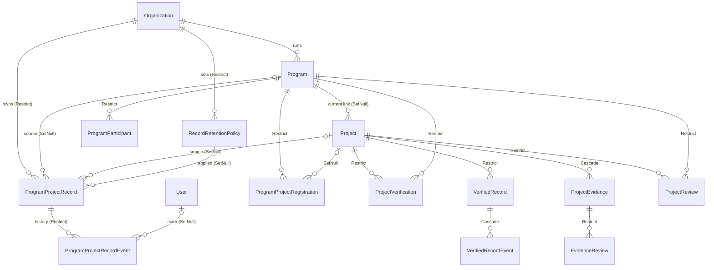

# 기관·기업 공식 프로젝트 기록 독립 보존 — 구조 분석과 설계

기준 브랜치: `feat/project-profile-display` (PR #10). 운영 DB와 AWS에는 적용하지 않는다.

## 1. 현재 구조

프로그램 프로젝트는 별도 사본 없이 `Project` 한 행을 학생 팀과 기관이 같이 쓴다. 기관이 남긴 기록은 모두 이 행에 FK로 매달려 있다.

| 모델 | 담는 것 | 부모 FK (현재 onDelete) |
| --- | --- | --- |
| `Program` | 기관 프로그램, 기수(`term`), 기간, 상태(DRAFT/ACTIVE/COMPLETED/ARCHIVED), 공개 정책 | Organization **Cascade** |
| `ProgramParticipant` | 프로그램 참여자(학번·학과 선택 입력) | Program **Cascade**, User Cascade |
| `ProgramProjectRegistration` | 프로젝트 연결 신청과 심사(PENDING/APPROVED/REJECTED/WITHDRAWN/REMOVED), 신청 시점 스냅샷 | Program **Cascade**, Project **Cascade** |
| `ProjectVerification` | 기관의 프로젝트 성과 인증(VERIFIED/REVOKED), 스냅샷·해시 | Project **Cascade**, Program **Cascade**, Organization **Cascade** |
| `VerifiedRecord` | 학생별 인증 기록(증빙 단위·기여 단위), 스냅샷·해시, 공개 범위 | Project **Cascade**, User Cascade, Program/Org SetNull |
| `VerifiedRecordEvent` | 인증 기록 발급·철회·재발급 이력 | VerifiedRecord Cascade |
| `ProjectEvidence` | 활동 증빙(DRAFT→SUBMITTED→APPROVED/REJECTED/REVOKED) | Project **Cascade**, Author(User) Cascade |
| `EvidenceReview` | 증빙 제출·승인·반려·철회 이력 | ProjectEvidence **Cascade** |
| `ProjectReview` | 기관 피드백·수정 요청·제외 요청 | Project **Cascade**, Program **Cascade** |
| `Project.programId` | 현재 소속 프로그램 | Program SetNull |

## 2. 확인된 위험

1. **공식 기록이 원본 생명주기에 종속된다.** `Project`·`Program`·`Organization` 행이 지워지면 검증, 인증 기록, 증빙 심사 이력, 기관 피드백이 DB Cascade로 함께 사라진다. PR #9가 API 계층에서 삭제를 막지만, DB 계층의 마지막 방어선은 없다.
2. **기관 기록이 따로 없다.** 기관이 보는 기록은 학생이 계속 편집하는 원본 프로젝트의 현재 값이다. 프로그램 종료 시점의 팀 구성, 역할, 성과를 고정해 둔 기록이 없다.
3. **정정·철회가 원본을 덮어쓴다.** `ProjectVerification`에는 REVOKED 상태와 사유가 남지만, 프로젝트 단위로 "언제 무엇이 어떻게 바뀌었는지"를 담은 이력은 없다.
4. **반려·철회된 연결 신청이 학생 삭제와 함께 사라진다.** 기관 심사 기록인데도 Project Cascade로 지워진다.
5. **참여자 제외가 행 삭제다.** `ProgramParticipant`가 삭제되면 프로그램 단위의 참여 이력은 사라진다. 이번 범위에서는 프로젝트 공식 기록이 참여자를 스냅샷으로 보존하고, 참여자 행의 소프트 삭제는 후속 과제로 둔다.
6. **보존 기간 정책이 없다.** 기관별 근거(법령·계약·서비스 정책)와 기간을 담을 구조가 없다.
7. **기관 보존 권한과 기업 인재 검색 권한이 구분돼 있지 않다.** 기업이 운영한 프로그램의 기록이 인재 검색 근거로 섞일 위험이 있다. 현재 인재 검색은 공식 기록 테이블을 읽지 않으며, 이 분리를 테스트로 고정한다.

## 3. 설계

### 3.1 모델



**`ProgramProjectRecord`**: 프로그램과 프로젝트 한 쌍마다 기관 공식 기록 1건.
- `organizationId` (Restrict), `programId`·`projectId` (SetNull. 원본이 지워져도 기록은 남는다)
- 원본 없이도 읽을 수 있는 식별 정보: `organizationName`, `programTitle`, `programTerm`, `projectTitle`
- `status`: `ACTIVE`(진행 중, 기관 행위마다 갱신) / `FINAL`(프로그램 종료 또는 프로젝트 제외로 확정)
- `snapshot`(현재 판), `contentHash`, `version`
- `capturedAt`, `finalizedAt`, `retainUntil`, `retentionPolicyId`
- 유니크 `(programId, projectId)`. 원본이 지워져 null이 되면 유니크 대상에서 빠진다.

**`ProgramProjectRecordEvent`**: 추가만 하는 이력.
- `action`: CAPTURED / UPDATED / FINALIZED / REOPENED / CORRECTED / REDACTED
- `trigger`: 예) `registration.approved`, `project.verified`, `evidence.approved`, `program.completed`, `project.removed`, `backfill`, `correction`
- 그 판의 전체 `snapshot`, `contentHash`, `previousHash`, `version`, `actorId`, `reason`
- 판을 바꿀 때마다 이전 판은 이벤트에 그대로 남는다. 현재 판(`snapshot`)만 갱신되고, 이력은 조용히 덮어쓰지 않는다.

**`RecordRetentionPolicy`**: 기관별 보존 정책. 기간을 코드에 고정하지 않는다.
- `basis`: LAW / CONTRACT / SERVICE_POLICY, `reference`(근거 조항·계약·정책 문서), `retentionMonths`(null이면 만료일 미설정)
- 기관당 유효 정책 1건(`retiredAt` null). 바꾸면 이전 정책을 은퇴시키고 새 행을 만든다(정책 이력 보존).
- 기록이 FINAL로 확정될 때 그 시점의 유효 정책으로 `retainUntil`을 계산해 고정한다. 정책이 없으면 `retainUntil`은 null로 두고, **자동 삭제는 하지 않는다**(만료 처리 작업은 법무 검토 후 별도 PR).

### 3.2 스냅샷 (개인정보 최소화)

```jsonc
{
  "v": 1,
  "organization": { "id", "name", "type" },
  "program": { "id", "title", "term", "startDate", "endDate", "status" },
  "project": { "id", "title", "teamName", "startDate", "endDate", "status" },
  "participants": [{ "userId", "name", "role", "joinedAt", "onTeam": true }],  // 이메일·연락처·학번 제외
  "registration": { "status", "source", "reviewedAt", "reviewer" } | null,
  "verification": { "status", "outcomeSummary", "verifiedAt", "verifier", "revokedAt", "revokeReason", "contentHash" } | null,
  "evidence": [{ "id", "title", "category", "activityDate", "status", "author", "reviewedAt", "reviewer", "files": [{ "name", "sha256" }] }], // DRAFT 제외
  "records": [{ "id", "userId", "kind", "status", "role", "verifiedAt", "revokedAt", "contentHash" }],
  "reviews": [{ "kind", "status", "createdAt" }],   // 피드백 본문 제외
  "corrections": [{ "at", "by", "reason", "note" }]
}
```

### 3.3 생성·확정 시점

| 시점 | 동작 |
| --- | --- |
| 연결 신청 승인, 담당자의 프로젝트 생성·이동 | 기록 생성(CAPTURED), 이동 시 이전 프로그램 기록 확정 |
| 프로젝트·팀원 검증, 검증 취소 | 판 갱신(UPDATED) |
| 증빙 승인·반려·철회 | 판 갱신(UPDATED) |
| 프로그램에서 프로젝트 제외 | 확정(FINALIZED, `project.removed`) |
| 프로그램 상태 COMPLETED/ARCHIVED | 그 프로그램의 기록 전부 확정(FINALIZED, `program.completed`) |
| 확정 이후의 변경(검증 취소 등) | 상태는 FINAL을 유지하고 판을 올린다(CORRECTED). 확정 판은 FINALIZED 이벤트에 남는다 |
| 같은 프로젝트 재연결 | REOPENED 후 ACTIVE |
| 담당자 정정 | 사유와 메모를 `corrections`에 추가(CORRECTED) |
| 개인정보 삭제 요청(기관 관리자) | 해당 참여자의 이름·역할을 현재 판과 과거 판 전부에서 가린다(REDACTED, 사유만 기록). 이력 변경이 허용되는 유일한 경우다 |

내용 해시가 같으면 새 판을 만들지 않는다(멱등).

### 3.4 권한

- 조회: 기록 소유 기관의 OWNER·ADMIN은 기관 기록 전부, 그 외 구성원은 **자신이 담당하는 프로그램의 기록만**. 원본 프로그램이 지워진 기록은 OWNER·ADMIN만 본다. 다른 기관·기업은 404.
- 정정: 담당 프로그램 스태프와 OWNER·ADMIN. 비식별화와 보존 정책 변경: OWNER·ADMIN.
- 승인되지 않은 기관에는 권한이 없다(`requireApproved`).
- **기관의 보존 권한은 기업의 인재 검색 권한이 아니다.** 인재 검색은 학생 동의, 프로필 숨김, 프로젝트 공개 범위, 인증 기록 공개 범위만 따른다. 공식 기록 테이블은 읽지 않으며, 기업이 운영한 프로그램이어도 같다.
- 학생의 프로필 숨김은 공식 기록에 영향이 없다.

### 3.5 FK 정책 변경

| FK | 현재 | 변경 | 이유 |
| --- | --- | --- | --- |
| Program → Organization | Cascade | **Restrict** | 기관 삭제로 프로그램과 기록이 연쇄 삭제되지 않게 |
| ProgramParticipant → Program | Cascade | **Restrict** | 참여 이력 보호(프로그램 삭제는 이미 API에서 차단) |
| ProgramProjectRegistration → Program | Cascade | **Restrict** | 심사 기록 보호 |
| ProgramProjectRegistration → Project | Cascade | **SetNull** (nullable) | 반려·철회 신청은 기관 심사 로그로 남기고, 학생의 개인 프로젝트 삭제는 허용 |
| ProjectVerification → Project/Program/Organization | Cascade | **Restrict** | 검증 기록 보호 |
| VerifiedRecord → Project | Cascade | **Restrict** | 인증 기록 보호 |
| EvidenceReview → ProjectEvidence | Cascade | **Restrict** | 제출·심사된 증빙은 지울 수 없게(임시저장 증빙에는 심사 이력이 없어 삭제 가능) |
| ProjectReview → Project/Program | Cascade | **Restrict** | 기관 피드백 보호 |
| ProgramProjectRecord → Organization, Event → Record | (신규) | **Restrict** | 공식 기록 보호 |
| ProgramProjectRecord → Program/Project | (신규) | **SetNull** | 원본과 독립 |
| VerifiedRecord/ProjectEvidence → User, ProgramParticipant → User | Cascade | 유지 | 계정 삭제 API가 없다. 계정 삭제를 만들 때 비식별화 절차와 함께 다시 설계한다 |
| ProjectEvidence → Project | Cascade | 유지 | 임시저장 증빙은 개인 프로젝트와 함께 지운다. 제출 이후 증빙은 EvidenceReview Restrict와 API 차단으로 보호 |

### 3.6 연결 신청 보존 정책

- APPROVED/REMOVED: 공식 참여 이력. 프로젝트 삭제를 막고(PR #9) 공식 기록으로 확정한다.
- PENDING: 프로젝트 삭제를 막는다(PR #9). 신청을 철회한 뒤에 삭제할 수 있다.
- REJECTED/WITHDRAWN: 공식 기록은 만들지 않는다. 신청 시점 스냅샷이 담긴 심사 로그로 남기고, 학생이 프로젝트를 지우면 원본 링크만 끊는다(`projectId` → null). 보존 기간은 기관 보존 정책을 따른다.

## 4. 기존 데이터 영향

- 신규 테이블 3개. 기존 데이터는 삭제·변경하지 않는다.
- `ProgramProjectRegistration.projectId`의 NOT NULL을 해제한다(기존 값 유지).
- FK onDelete 변경은 제약을 다시 만드는 것뿐이며 데이터는 그대로다. 변경 후 Restrict 대상이 남아 있으면 원본 삭제가 DB에서 거부된다. 현재 API는 이미 그 경우를 409로 막으므로 사용자 동작은 같다.
- 백필: 프로그램에 연결됐거나 연결 이력(APPROVED/REMOVED), 검증, 프로그램 인증 기록이 있는 프로젝트마다 공식 기록 1건을 만든다. 종료·보관된 프로그램과 제외된 프로젝트는 FINAL로 만든다. 멱등이라 다시 실행해도 중복이 생기지 않는다.
- 로컬 E2E 시드의 정리 단계가 기관을 지우는 방식이라 Restrict 순서에 맞게 바꾼다(로컬 전용).

## 5. 마이그레이션·백업·롤백

1. **백업**: 스테이징 적용 전 `deploy/scripts/backup-db.sh`(또는 `pg_dump -Fc`)로 전체 백업을 남기고 복원 리허설을 한다.
2. **마이그레이션** `20261020000000_official_project_records`: 테이블·enum 생성, registration `projectId` NULL 허용, FK 재생성. 파괴적 구문은 없다(CI destructive guard 통과).
3. **백필**: `npx tsx scripts/backfillProgramProjectRecords.ts`는 dry run으로 건수만 보고한다. `--apply`로 실제 생성하며, 운영 환경에서는 `--confirm-backup` 없이는 실행되지 않는다. 스테이징에서 dry run → apply → 건수 대조 순서로 진행한다.
4. **롤백**: 앱을 이전 버전으로 되돌린 뒤 역마이그레이션 SQL(`rollback.sql`, 마이그레이션 폴더에 동봉)을 실행한다. 신규 테이블 3개와 enum을 삭제하고 FK를 원래 Cascade로 다시 만든 뒤 `_prisma_migrations` 행을 지운다. 롤백 전에 registration `projectId`가 null인 행이 있으면 NOT NULL 복원이 실패하므로, 해당 행을 먼저 별도 테이블로 내보내야 한다(스크립트에 포함). 공식 기록 테이블을 지우기 전에도 `pg_dump -t`로 내보낸다.
5. 운영 DB와 AWS에는 이 PR에서 아무것도 적용하지 않는다.

## 6. 테스트

- 개인이 프로젝트를 숨겨도 기관 기록이 유지된다.
- 다른 팀원의 이력이 유지된다.
- 프로그램 종료 후 기록이 확정되고 조회된다(원본 프로젝트가 바뀌어도 확정 판은 그대로).
- 검증 취소와 정정 이력이 보존되고, 이전 판이 이벤트에 남는다.
- 다른 기관, 담당하지 않는 구성원, 기업은 접근할 수 없다. 기업 인재 검색은 공식 기록을 쓰지 않는다.
- 원본 삭제 API가 보호되고, DB Restrict가 직접 삭제도 막는다. 반려된 신청은 프로젝트 삭제 후에도 남는다.
- 마이그레이션은 CI 업그레이드 경로 검사로, 백필은 멱등성과 FINAL 판정으로 검증한다.

## 7. 후속 PR

- 기관 공식 기록 화면(기관 콘솔)
- `ProgramParticipant` 소프트 삭제
- 보존 만료 처리 작업(법무 검토 후)
- 계정 삭제·비식별화 절차
- 프로필 V2, Talent DB V2
